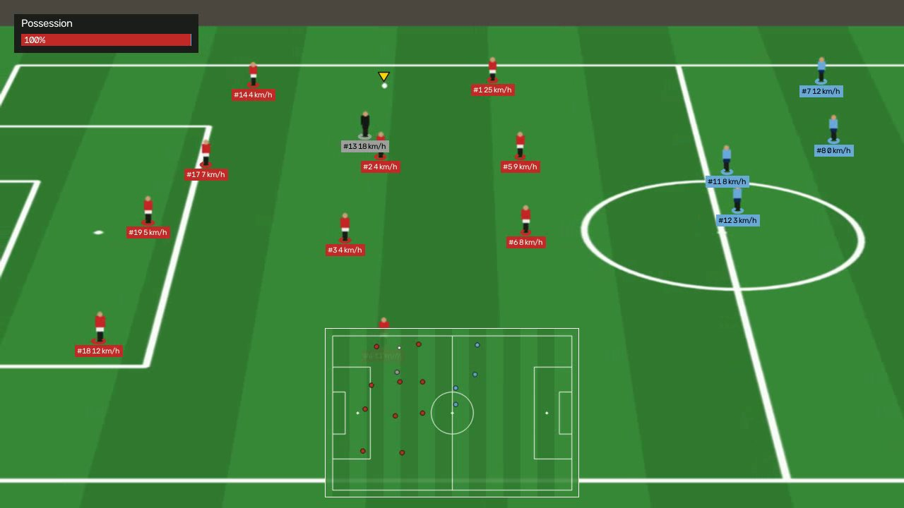
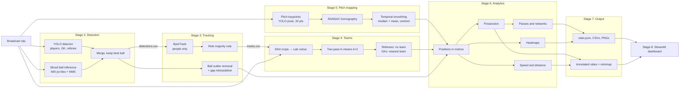
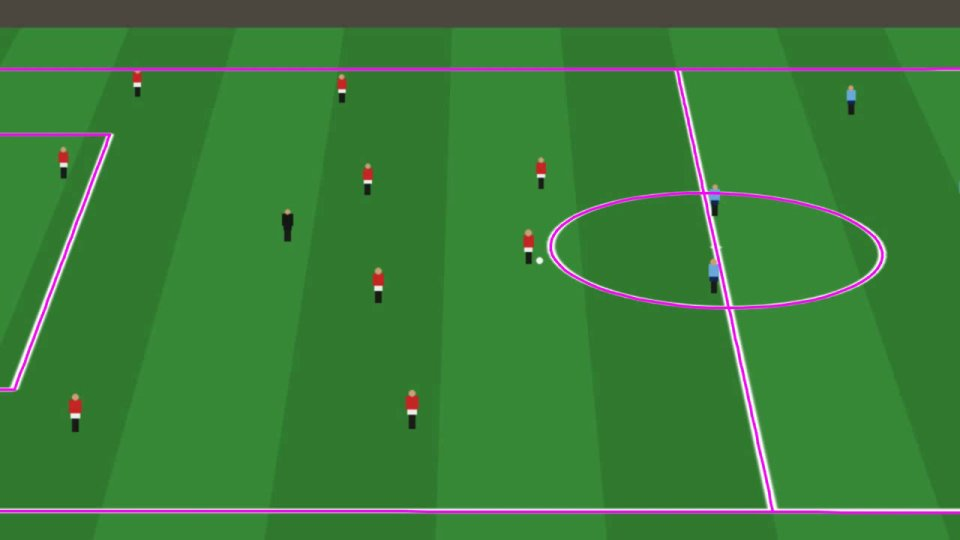
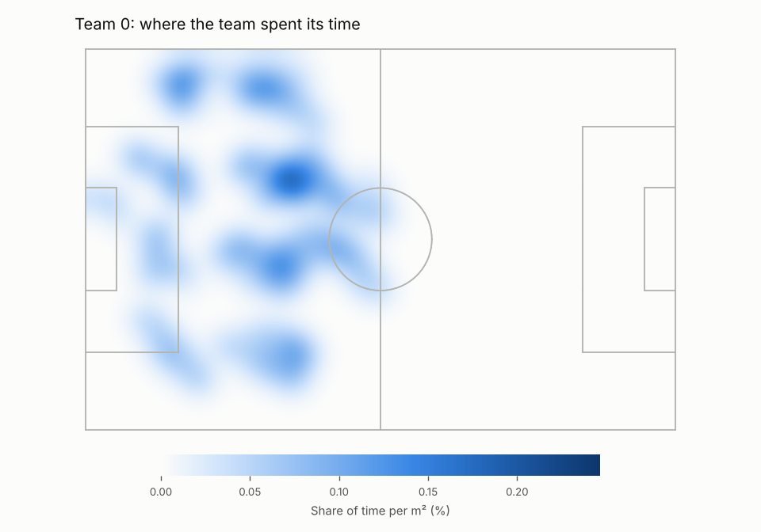
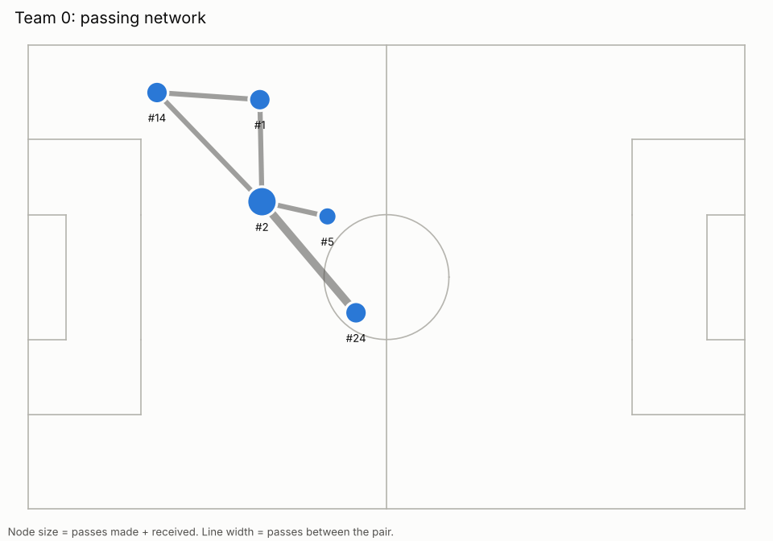
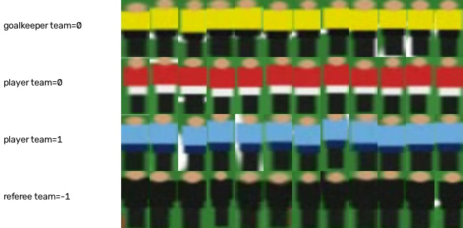
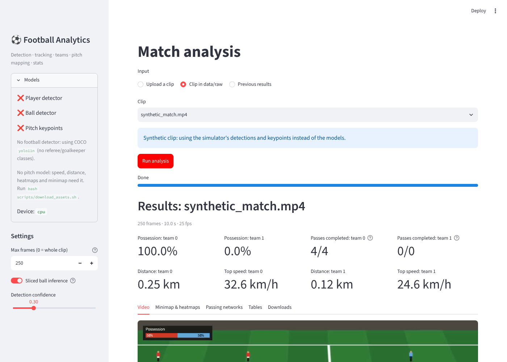

# Football Analytics: broadcast video to match stats

Turn a broadcast football clip into an **annotated video** and **match statistics**:
player and ball detection, tracking with stable IDs, automatic team assignment,
pixel-to-pitch mapping in metres, ball possession, passes, speed and distance,
team heatmaps, passing networks and a 2D minimap. Run it from the command line or a
Streamlit dashboard.


<sub>Output frame from the built-in synthetic test match: kit-coloured player IDs with
live speed, possession bar, ball marker and minimap. Real broadcast clips can be
downloaded; see [Data and models](#data-and-models).</sub>

**Stack:** Python 3.11 · Ultralytics YOLO · supervision · ByteTrack (`trackers`) ·
OpenCV · scikit-learn · pandas · matplotlib · Streamlit

---

## Contents

- [Features](#features)
- [Architecture](#architecture)
- [Quick start](#quick-start)
- [Data and models](#data-and-models)
- [Outputs](#outputs)
- [Validation](#validation)
- [Limitations](#limitations)
- [Results for your resume](#results-for-your-resume)
- [Project structure](#project-structure)
- [Development](#development)

Detailed notes on every stage are in [docs/PIPELINE.md](docs/PIPELINE.md).

## Features

| Stage | What it does | How |
|---|---|---|
| Detection | Players, goalkeepers, referees, ball | YOLO (fine-tunable on Roboflow data); sliced inference finds the 5–15 px ball |
| Tracking | Stable IDs per person; full ball trajectory | ByteTrack; ball outlier removal plus gap interpolation |
| Teams | Two teams, referees and goalkeepers separated | Lab shirt colour, two-pass K-means, position rule for goalkeepers |
| Pitch mapping | Pixels to metres on a 105×68 m pitch | 32-keypoint YOLO pose model, RANSAC homography, offline temporal smoothing |
| Analytics | Possession %, passes, distance, speed, heatmaps, passing networks | Nearest-player control, control-spell changes, smoothed kinematics |
| Output | Annotated video, minimap, CSV and JSON stats | OpenCV rendering, H.264 copy for browsers |
| Dashboard | Upload a clip and explore the results | Streamlit |

Runs on CPU and uses a GPU automatically when one is available. If an optional model
is missing, the run still finishes with fewer outputs and explains what to download.

## Architecture



Each stage is a small module with its own CLI. It reads the previous stage's files
from `outputs/<clip>/` and writes its own, so any stage can be re-run on its own.
`src/pipeline.py` chains them.

## Quick start

```bash
# 1. Environment (Python 3.11)
python3.11 -m venv .venv && source .venv/bin/activate
pip install -r requirements.txt           # CPU-only machine? See "Setup notes" below
pytest -q                                 # 62 tests, ~15 s, no downloads needed

# 2. Try it with no downloads: the synthetic match
python -m src.simulation                  # 20 s clip + simulated detections + ground truth
python -m src.run --input data/raw/synthetic_match.mp4 \
    --detections data/synthetic/synthetic_match/detections.csv \
    --keypoints  data/synthetic/synthetic_match/keypoints.csv
python -m src.simulation.evaluate         # score the run against ground truth

# 3. Real footage (after the downloads below)
python -m src.run --input data/raw/0bfacc_0.mp4 --max-frames 250

# 4. Dashboard
streamlit run streamlit_app.py
```

Every stage can also be run on its own:

```bash
python -m src.detect       --input clip.mp4   # stage 2 -> detections.csv, detections.mp4
python -m src.track        --input clip.mp4   # stage 3 -> tracks.csv, ball.csv, tracks.mp4
python -m src.assign_teams --input clip.mp4   # stage 4 -> teams.csv, team_crops.jpg
python -m src.map_pitch    --input clip.mp4   # stage 5 -> positions.csv, pitch_overlay.mp4
python -m src.analyze      --input clip.mp4   # stage 6 -> stats, heatmaps, passing networks
```

All commands accept `--max-frames N`, `--device cpu|cuda:0|mps`, `--config` and
`--output-dir`. Thresholds are in [`config.yaml`](config.yaml).

**Setup notes.** On Linux, PyPI's `torch` is the CUDA build. It works on CPU but is
about 2 GB larger. For a CPU-only install, run this first:
`pip install torch==2.14.1 torchvision==0.29.1 --index-url https://download.pytorch.org/whl/cpu`.

## Data and models

You don't need to record any footage. Everything is public. Nothing large is
committed to git.

### 1. Sample clips and pretrained football models (recommended)

Roboflow's open-source [sports](https://github.com/roboflow/sports) project publishes
YOLOv8 models trained on football data, plus five 30-second broadcast clips from the
Kaggle [DFL - Bundesliga Data Shootout](https://www.kaggle.com/competitions/dfl-bundesliga-data-shootout).
They are hosted on Google Drive:

```bash
pip install gdown
bash scripts/download_assets.sh
```

| File | Used for |
|---|---|
| `models/football-player-detection.pt` | ball / goalkeeper / player / referee detection |
| `models/football-ball-detection.pt` | dedicated ball detector (sliced inference) |
| `models/football-pitch-detection.pt` | 32 pitch keypoints (stage 5) |
| `data/raw/{0bfacc_0,2e57b9_0,08fd33_0,573e61_0,121364_0}.mp4` | sample clips |

If Google Drive refuses the download, accept the Kaggle competition's rules, download
any file from its `clips/` folder and put it in `data/raw/`.

### 2. Training datasets (only for fine-tuning)

From Roboflow Universe (free account; API key at https://app.roboflow.com/settings/api):

| Dataset | Version | Task |
|---|---|---|
| [football-players-detection-3zvbc](https://universe.roboflow.com/roboflow-jvuqo/football-players-detection-3zvbc) | 10 | detection, 4 classes |
| [football-ball-detection-rejhg](https://universe.roboflow.com/roboflow-jvuqo/football-ball-detection-rejhg) | 2 | detection, ball only |
| [football-field-detection-f07vi](https://universe.roboflow.com/roboflow-jvuqo/football-field-detection-f07vi) | 12 | pose, 32 keypoints |

```bash
pip install -r requirements-train.txt
export ROBOFLOW_API_KEY=your_key
python -m src.detection.download_dataset --dataset players      # or: ball, pitch
python -m src.detection.train --config configs/train_detector.yaml
python -m src.detection.train --config configs/train_pitch.yaml # keypoint model
```

Trained weights are copied into `models/`, where the pipeline picks them up.

### 3. Without any downloads

With no football models, detection falls back to the COCO `yolo11n.pt` model, which
Ultralytics downloads automatically from GitHub. It finds people and balls but can't
tell referees and goalkeepers apart; colour outliers are then labelled `other`.
Without the pitch model, possession and passes are measured in pixels, and speed,
distance, heatmaps and the minimap are skipped with a warning.

## Outputs

Everything is written to `outputs/<clip>/`:

| File | Contents |
|---|---|
| `annotated.mp4`, `annotated_h264.mp4` | final video; the H.264 copy plays in browsers |
| `stats.json` | possession %, passes, distance and top speed per team, top players, warnings |
| `team_summary.csv`, `player_stats.csv` | per team and per player stats |
| `passes.csv`, `possession.csv`, `speeds.csv` | event and per-frame data |
| `heatmap_team{0,1}.png`, `passing_network_team{0,1}.png` | charts |
| `detections.csv`, `tracks.csv`, `ball.csv`, `teams.csv`, `keypoints.csv`, `homographies.csv`, `positions.csv` | intermediate data from each stage |

| Pitch-line overlay (homography check) | Team heatmap | Passing network |
|---|---|---|
|  |  |  |

| Team clustering contact sheet | Dashboard |
|---|---|
|  |  |

<sub>All images come from the synthetic test match.</sub>

## Validation

Real broadcast footage has no ground truth for player positions, so the project
includes a **synthetic match simulator** (`src/simulation/`). It plays out a
4-4-2 vs 4-4-2 passage with passes and interceptions. It renders the play through a
broadcast-style camera that **pans and zooms**, then generates detector-like boxes
(jitter, 3% missed people, 30% missed balls, false balls) and noisy pitch keypoints
(1.5 px noise, 10% missing). Stages 3–7 run on those inputs exactly as they would on
model output, and `python -m src.simulation.evaluate` compares the results with the
truth.

Results on the default 20-second synthetic match (500 frames, seed 2):

| Component | Metric | Result |
|---|---|---|
| Team assignment | track-level accuracy | **100%** (30 tracks); referees correctly given no team |
| Pitch mapping | player position error, mean / p95 | **0.14 m / 0.32 m** (0.71 m / 0.60 m without temporal smoothing) |
| Pitch mapping | ball position error, mean | **0.09 m** |
| Possession | team share, estimated vs true | **82.6% vs 83.2%**; 99.4% of frames agree |
| Passes | precision / recall | **8/8 and 8/8** (7 completed, 1 interception) |
| Distance covered | error per player | **+1.6%** mean, 2.4% absolute (**+55%** without smoothing) |
| Tracking | track IDs per true person | 1.78 (mostly players leaving and re-entering the frame) |

**What this does and doesn't show:** it checks the logic after detection (tracking,
clustering, geometry, analytics) against known answers, under realistic camera
motion and noise. It doesn't measure detector accuracy on real footage. The rendered
figures are simple, and real kits, lighting and occlusion are harder.

**Speed on CPU** (4 cores, 1280×720, COCO `yolo11n` fallback): the detector runs at
8.2 fps and sliced ball inference at 3.2 fps. Everything after detection (tracking to
rendered video) processes the 500-frame synthetic clip in about 12 s. The larger
YOLOv8x football models are much slower on CPU, so use a GPU or `--max-frames` for
long clips.

## Limitations

- **Ball detection.** The ball is often 5–15 px wide, motion-blurred, or hidden by
  players. Sliced inference helps recall at about 4× the cost. Gaps over 1 s aren't
  filled. A ball **in the air** is projected to the wrong pitch position, because the
  homography only knows the ground plane. Possession and passes then rely on the
  "last team in control" rule.
- **ID switches and re-entry.** ByteTrack matches on motion and box overlap only.
  A player who leaves the frame for more than 2 s comes back with a new ID, and
  crossing players can swap IDs. Per-player totals are therefore split across IDs.
  Measured on the synthetic match: 1.78 IDs per person. Re-identifying players by
  appearance or shirt number would fix this.
- **Camera zoom, replays and cuts.** The homography needs at least 4 confident pitch
  keypoints. Close-ups, replays and crowd shots don't have them. Smoothing bridges up
  to 1 s; longer gaps leave positions empty, and metric stats skip those frames. Scene
  cuts aren't detected explicitly. Errors grow towards the far touchline, where one
  pixel covers more metres.
- **Team colours.** Two-cluster K-means assumes clearly different kits. Similar
  colours, heavy shadows, or a kit close to the grass colour can confuse it.
  Goalkeepers are assigned by position, not colour.
- **Possession and passes are heuristics.** They use the nearest player within 2 m
  and control lasting at least 0.4 s, so one-touch passes and deflections can be
  missed or merged.
- **Speeds** come from smoothed homography positions. Top speed is a 95th-percentile
  reading, deliberately conservative, and won't match GPS tracking data.
- **Evaluation** covers stages 3–7 on synthetic data only (see [Validation](#validation)).

## Results for your resume

Every number below was measured in this repository. Numbers in **[brackets]** are
blanks for you to fill in after running on real clips, ideally on a GPU, so you can
stand behind them.

- Built an end-to-end computer-vision pipeline that turns broadcast football video
  into an annotated video and match statistics (possession, passes, distance, speed,
  heatmaps, passing networks, 2D minimap). Uses YOLO, ByteTrack, K-means, a
  homography to pitch coordinates, and a Streamlit dashboard.
- Mapped players from pixels to a 105×68 m pitch using a 32-keypoint pose model and
  RANSAC homography. Designed an offline temporal smoothing step that cut position
  error from 0.71 m to **0.14 m** (mean) under a panning, zooming camera.
- Built a synthetic match simulator with ground truth to validate the analytics:
  **100%** team-assignment accuracy, possession within **0.6 points** of the truth, and
  **8/8** passes detected with no false positives. Distance error went from **+55% to
  +1.6%** after tuning kinematic smoothing.
- Improved small-ball recall with sliced (tiled) inference and trajectory
  interpolation; ball coverage on real clips **[X% of frames detected, Y% after
  interpolation]**.
- Processed **[N]** Bundesliga broadcast clips at **[X] fps** on **[GPU]**; fine-tuned
  YOLO on the Roboflow football dataset to **[mAP50 = X]** (from
  `runs/detect/football-players/results.csv`).
- Engineered for maintainability: 62 pytest tests (including end-to-end runs scored
  against ground truth), type-checked with mypy, linted with ruff, CI on GitHub
  Actions, and modular stage CLIs.

## Project structure

```
config.yaml              paths, model locations and every threshold
configs/                 YOLO training configs (detector, pitch keypoints)
src/
  run.py                 full pipeline CLI: python -m src.run --input clip.mp4
  pipeline.py            chains stages; degrades gracefully without optional models
  detect.py, track.py, assign_teams.py, map_pitch.py, analyze.py   per-stage CLIs
  detection/             YOLO wrapper, class mapping, sliced ball inference, training, dataset download
  tracking/              ByteTrack wrapper, ball outlier removal and interpolation
  team_assignment/       shirt crops, Lab colour features, K-means, referee/goalkeeper rules
  pitch/                 105x68 m template (32 keypoints), homography + smoothing, drawing
  analytics/             possession, passes, kinematics, heatmaps, passing networks
  visualization/         frame annotators, minimap
  simulation/            synthetic match generator and evaluation
  utils/                 config, device selection, video I/O, run paths, progress
streamlit_app.py         dashboard
scripts/                 asset download, smoke-test clip
tests/                   62 tests: units, homography, teams, analytics, CLI, app, end-to-end
docs/                    pipeline details and example images
notebooks/               for your own exploration of outputs/ (empty)
data/, models/, outputs/ local only (git-ignored)
```

## Development

```bash
pip install -r requirements-dev.txt
ruff check .                    # lint
mypy src streamlit_app.py       # types
pytest -q                       # tests
```

GitHub Actions runs all three on every push (`.github/workflows/ci.yml`), with
CPU-only PyTorch.

### Acknowledgements

Sample clips: DFL - Bundesliga Data Shootout (Kaggle). Pretrained models, datasets
and the 32-keypoint pitch layout: Roboflow's [sports](https://github.com/roboflow/sports)
project and Roboflow Universe. Check each source's licence before redistributing
clips or weights.
